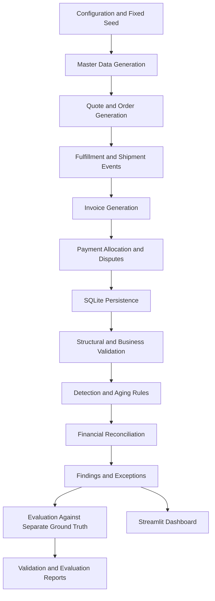
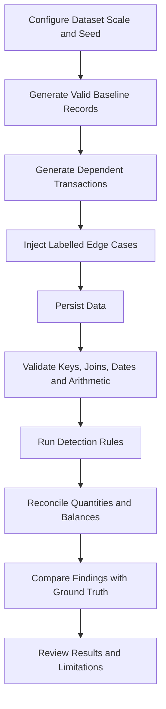

# YottaFlex O2C Detection System
## Order-to-Cash Revenue Leakage and Process Delay Analysis

A reproducible, explainable analytics solution for tracking the Order-to-Cash (O2C) lifecycle and identifying potential revenue leakage, process delays, billing discrepancies, payment exceptions, and disputes.

**Repository:** [Manusha-M/AI-order-to-cash-detection-system](https://github.com/Manusha-M/AI-order-to-cash-detection-system)

---

## 1. Business Context and Problem

The Order-to-Cash process begins when a customer receives a quote and continues through order creation, fulfillment, invoicing, payment collection, and dispute resolution.

Errors, missing transitions, incomplete fulfillment, billing discrepancies, and payment delays can create revenue leakage or operational inefficiencies.

This project analyzes the O2C lifecycle to identify potential exceptions, preserve traceability to source records, and produce measurable validation and evaluation results.

The solution focuses on:

- Tracking quote, order, fulfillment, invoice, payment, and dispute states
- Identifying potential revenue leakage and process delays
- Detecting billing and payment exceptions
- Preserving lifecycle state changes as explicit events
- Reconciling operational quantities and financial balances
- Evaluating detection outcomes against separate ground truth

## 2. Objective and Scope

The objective is to build a working, end-to-end solution that:

1. Generates and maintains related O2C business entities.
2. Applies conditional business rules to lifecycle transitions.
3. Detects exceptions and potential revenue leakage.
4. Preserves traceability from findings to source records and events.
5. Produces measurable validation and evaluation outputs.
6. Supports reproducible generation and execution.
7. Provides an interface for reviewing analytical results.

The solution includes multiple related entities, conditional rules, exception paths, financial reconciliation, and evaluation against known synthetic anomalies.

## 3. Primary Actors and Systems

| Actor or System | Responsibility |
|---|---|
| Customer / Prospect | Receives quotes, places orders, makes payments, and may raise disputes |
| Marketing / Sales Operations | Creates accounts and quotes and manages quote acceptance |
| Support Agent | Reviews customer issues and dispute-related information |
| Analyst | Reviews findings, reconciliation results, aging, and process exceptions |
| System Administrator | Maintains configuration, execution, and data integrity |
| O2C Analytics System | Generates data, validates records, detects exceptions, and produces reports |

## 4. Business Workflow and Rules

### High-Level Workflow

```text
Account → Quote → Sales Order → Shipment → Invoice → Payment
                                              └────→ Dispute
```

The implementation expands this workflow with line-level records, payment allocations, and lifecycle events.

### Business Rules

1. Generate or reference master data first:
   - Account
   - Quote
   - QuoteLine
   - SalesOrder
   - OrderLine

2. Generate dependent transaction and event records using valid parent IDs.

3. Apply lifecycle logic:
   - Create accounts and quotes.
   - Convert accepted quotes into sales orders.
   - Generate fulfillment and shipment events.
   - Invoice fulfilled quantities.
   - Record payments and payment allocations.
   - Record disputes and their relationships to relevant business records.
   - Calculate aging and exception rules.
   - Preserve state changes as events.

4. Persist relevant state changes as explicit records or events. Do not overwrite historical state changes.

5. Generate derived outcomes and ground-truth labels from documented business rules rather than independent random assignment.

6. Validate relationships, lifecycle transitions, and financial calculations before evaluating detection results.

## 5. Architecture



### Methodology



The pipeline separates data generation, anomaly creation, detection, and evaluation. Ground-truth labels are maintained separately and are not used as detection inputs.

## 6. Entities and Relationships

The core entities are:

| Entity | Description |
|---|---|
| Account | Customer or prospect master record |
| Quote | Commercial offer associated with an account |
| QuoteLine | Individual product or service line within a quote |
| SalesOrder | Order created from an accepted quote |
| OrderLine | Individual line within a sales order |
| Shipment | Fulfillment transaction |
| Invoice | Billing document |
| InvoiceLine | Individual billed line and quantity |
| Payment | Payment received from a customer |
| Dispute | Customer dispute related to an O2C transaction |
| StatusEvent | Historical record of a lifecycle state change |

### Relationship Design

The data model documents and validates:

- Primary keys for every entity
- Foreign keys for every relationship
- Relationship cardinality: 1:1, 1:N, and N:M where applicable
- Optional and required relationships
- Effective dates and lifecycle states
- Bridge tables for many-to-many relationships
- Event history for lifecycle changes
- Join integrity across related entities

### Traceability

Each finding should be traceable to its relevant source business records and, where applicable, the lifecycle events that produced the state being analyzed.

## 7. ID and Nomenclature Conventions

The project uses deterministic, immutable, zero-padded business identifiers.

| Entity | Required Format | Example |
|---|---|---|
| Quote | `QTE-2026-000001` | `QTE-2026-000001` |
| Sales Order | `SO-2026-000001` | `SO-2026-000001` |
| Shipment | `SHP-2026-000001` | `SHP-2026-000001` |
| Invoice | `INV-2026-000001` | `INV-2026-000001` |
| Payment | `PAY-2026-000001` | `PAY-2026-000001` |
| Dispute | `DSP-2026-000001` | `DSP-2026-000001` |

IDs remain immutable, and referenced IDs must be consistent across generated files and database relationships.

## 8. Synthetic Data Generation

The project uses synthetic data to demonstrate the O2C workflow without requiring confidential or personal business records.

### 8.1 Data Dictionary

A data dictionary should document the fields for:

- Account
- Quote
- QuoteLine
- SalesOrder
- OrderLine
- Shipment
- Invoice
- InvoiceLine
- Payment
- Dispute
- StatusEvent

For each field, document:

| Attribute | Description |
|---|---|
| Field name | Name used in the data model |
| Type | Data type |
| Required / Optional | Whether a value must be present |
| Allowed values | Valid values or enumerations |
| Units | Currency, quantity, days, or other units |
| Uniqueness | Whether the value must be unique |
| Validation rule | Rule used to validate the value |

### 8.2 Parent-First Generation

The generator follows dependency order:

1. Generate accounts.
2. Generate quotes and quote lines.
3. Convert accepted quotes into sales orders and order lines.
4. Generate shipment and fulfillment records.
5. Generate invoices from fulfilled quantities.
6. Generate payments and payment allocations.
7. Generate disputes and status events.
8. Calculate derived values, aging, and exception outcomes.

Dependent records must reference valid parent IDs.

### 8.3 Dataset Scale and Reproducibility

The target full-scale dataset includes:

| Record Type | Target Volume |
|---|---:|
| Quotes | 10,000 |
| Sales Orders | 7,000 |
| Invoices | 8,000 |
| Payments / Events | 15,000 |

The generator should support parameterized starter and full dataset scales using the same generation logic.

A fixed seed, such as `20261022`, is used to support reproducibility. The same seed and configuration should produce consistent records, row counts, and checksums.

### 8.4 Baseline and Anomaly Generation

Generate valid baseline records first. Then inject deliberate, labelled edge cases.

Required scenarios include:

- Partial shipment
- Underbilling
- Duplicate invoice
- Short payment
- Long-overdue balance
- Invoice exceeding fulfilled quantity
- Payment allocated twice
- Order closed with unpaid invoice
- Status event skipping a required state
- Dispute not reflected in receivables

For deliberate anomaly cases, retain an `issue_type` or `ground_truth` label. Do not silently corrupt unrelated records.

### 8.5 Derived Values

Calculate totals, balances, scores, statuses, and dates from source records and documented business rules rather than generating them independently.

Examples include:

- Quote totals from quote lines
- Order totals from order lines
- Fulfilled quantities from shipment records
- Invoice amounts from invoice lines
- Outstanding balances from invoice amounts and payment allocations
- Aging from invoice dates and a defined cutoff date
- Lifecycle state from recorded status events

### 8.6 Ground Truth

Generate a separate ground-truth artifact, such as CSV or JSON, containing known anomalies, expected decisions, or labels.

Ground truth must not be leaked into the input features used by detection rules.

## 9. Detection and Exception Analysis

The system applies deterministic, explainable rules to identify potential O2C exceptions.

Detection areas include:

- Fulfillment and invoicing discrepancies
- Potential duplicate invoices
- Short payments
- Unapplied or incorrectly allocated payments
- Overdue invoices and aging
- Dispute-related exceptions
- Lifecycle delays
- Inconsistent status transitions

Each finding should expose the relevant rule, affected business records, and supporting information needed for review.

A detected finding is a potential exception requiring review. It is not, by itself, proof of fraud or confirmed financial loss.

## 10. Financial Reconciliation

The solution compares operational and financial values across related records.

Reconciliation includes:

- Ordered quantities versus fulfilled quantities
- Fulfilled quantities versus invoiced quantities
- Invoice amounts versus payment allocations
- Invoice balances and outstanding receivables
- Dispute amounts and their treatment in receivables

Balances should reconcile according to documented rules, and discrepancies should remain traceable to their source records.

## 11. Validation Rules and Acceptance Criteria

The validation process checks:

| Validation Area | Expected Check |
|---|---|
| Primary keys | Unique and non-null |
| Foreign keys | Every referenced parent exists |
| Enumerations | Values belong to allowed states |
| Dates | Lifecycle dates follow valid ordering rules |
| Arithmetic | Totals, quantities, and balances reconcile |
| Lifecycle | State transitions follow documented rules |
| Duplicates | Duplicate records are detected according to defined criteria |
| Joins | Relationships produce valid and traceable results |
| Aging | Calculations use a defined cutoff date |
| Exceptions | Findings link to source records and events |
| Ground truth | Labels remain separate from detection inputs |
| Reproducibility | Same seed and configuration produce consistent outputs |

Acceptance criteria:

- O2C state is consistent across related entities.
- Financial balances reconcile according to documented rules.
- Exceptions are traceable to source records and events.
- Aging calculations use defined cutoff dates.
- Detection results can be evaluated against separate ground truth.
- The project can be installed, executed, and verified by another reviewer.

## 12. Evaluation

The generated data and detection results are reviewed for:

1. Realistic distributions and meaningful variation
2. Consistent IDs and valid joins
3. Dependency and lifecycle consistency
4. Correct derived values and financial reconciliation
5. Normal, boundary, failure, and exception coverage
6. Separation of ground truth from detection inputs
7. Fixed-seed reproducibility
8. Documentation, source manifest, and lawful provenance

Evaluation results should state the dataset scale and configuration used. Results from a starter dataset should not be represented as full-scale results.

## 13. Public Data Guidance and Lawful Use

External data is optional. Synthetic data is preferred when licensing, suitability, or redistribution rights are unclear.

If external data is used, document:

- Source URL
- Dataset name and version
- Retrieval date
- License and terms
- Required attribution
- Transformations performed
- Fields discarded

Use only data that is legally permitted to access and redistribute. Do not bypass access controls or collect confidential or personal information.

Public reference data may be used for schema inspiration when the underlying data is not included in the project.

## 14. Technology Stack

| Technology | Purpose |
|---|---|
| Python | Data generation, validation, detection, and analysis |
| SQLite | Relational data persistence |
| SQL | Schema and relational queries |
| Pandas | Data processing and analytical operations |
| Streamlit | Interactive dashboard |
| Pytest | Automated testing |

## 15. Repository Structure

```text
AI-order-to-cash-detection-system/
├── app/
├── data/
├── docs/
├── outputs/
├── scripts/
├── sql/
├── src/
├── tests/
├── HANDOFF.md
├── README.md
├── requirements.txt
├── pytest.ini
└── run.py
```

The repository contains the generator, database schema, validation and detection logic, dashboard, tests, supporting documentation, and generated analytical outputs.

## 16. Setup and Execution

### Requirements

- Python 3
- pip
- Git

### Clone the Repository

```bash
git clone https://github.com/Manusha-M/AI-order-to-cash-detection-system.git
cd AI-order-to-cash-detection-system
```

### Create a Virtual Environment

**Windows PowerShell:**

```powershell
py -3 -m venv .venv
.\.venv\Scripts\Activate.ps1
```

If activation is blocked by the current PowerShell execution policy:

```powershell
Set-ExecutionPolicy -Scope Process -ExecutionPolicy Bypass
.\.venv\Scripts\Activate.ps1
```

### Install Dependencies

```bash
python -m pip install --upgrade pip
pip install -r requirements.txt
```

### Run the Starter Pipeline

```bash
python run.py all --scale starter
```

### Run Validation

```bash
python run.py validate --scale starter
```

### Run Automated Tests

```bash
pytest
```

### Launch the Dashboard

```bash
streamlit run app/dashboard.py
```

The dashboard should be available locally at:

```text
http://localhost:8501
```

Refer to `HANDOFF.md` for additional execution details and project workflow notes.

## 17. Verification Results

The following results were verified locally on Windows using Python 3.13.7 with the **starter dataset**:

| Check | Result |
|---|---:|
| Structural validation | 98 / 98 passed |
| Business anomaly tie-outs | 6 / 6 matched ground truth |
| Automated tests | 208 passed |
| Test duration | 69.61 seconds |

Commands used:

```bash
python run.py validate --scale starter
pytest
```

These results apply to the verified starter-scale run. Full-scale results should be reported only after running and verifying the full-scale dataset separately.

## 18. Assumptions and Limitations

- The project uses synthetic data rather than live enterprise records.
- Detection rules are deterministic and explainable.
- Findings represent potential exceptions and require business review.
- Ground-truth evaluation applies to the controlled synthetic anomalies generated by the project.
- Results depend on dataset configuration, seed, and implemented rules.
- The solution is a candidate project and demonstration system, not a production financial control platform.
- Real-world deployment would require domain-specific rule review, data-quality assessment, access controls, monitoring, and integration testing.
- Any incomplete requirements or deviations should be documented in the final audit and explained during the walkthrough.

## 19. Supporting Documentation

| Document | Purpose |
|---|---|
| `docs/development_log.md` | Chronological milestones, debugging, testing, and verification |
| `docs/prompt_history.md` | AI prompts used during development, with timestamps |
| `docs/ai_usage.md` | AI usage and contribution disclosure |
| `docs/decisions.md` | Technical decisions, trade-offs, and issues encountered |
| `docs/validation_report.md` | Measured validation and testing results |
| `docs/final_audit.md` | Requirement audit and open items |

---

## Development History and Evidence

This project was built locally with Claude Code in one session on 30 October 2026, without Git, and published to GitHub afterwards. That is why the repository history starts with one large commit. Later commits are changes made after publication.

The development log is a separate record from the Git history. These documents show how the solution evolved before publication:

| Document | What it records |
|---|---|
| `docs/development_log.md` | Chronological record of milestones, debugging, testing and final verification |
| `docs/prompt_history.md` | AI prompts, with timestamps |
| `docs/ai_usage.md` | AI usage and contribution disclosure |
| `docs/decisions.md` | Technical decisions, trade-offs and the bugs found along the way |
| `docs/validation_report.md` | Measured testing and validation results |
| `docs/final_audit.md` | Final requirement audit and open items |

## AI-Assisted Development

This project was built with Claude Code from the prompt in `docs/prompt_history.md`. That master prompt was created with ChatGPT.

AI wrote the code, tests and documentation, and ran the checks reported here. What the candidate reviewed, and how the prompts relate to the final submission, is stated in `docs/ai_usage.md`. That file is the authoritative record.

## Author

**Manusha Manne**

GitHub: [Manusha-M](https://github.com/Manusha-M)
