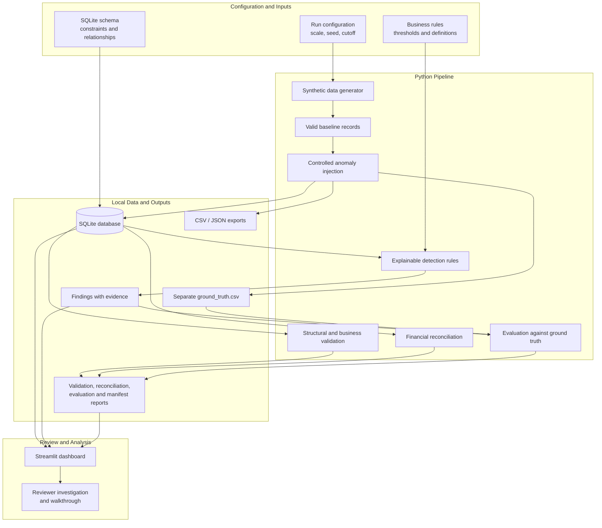
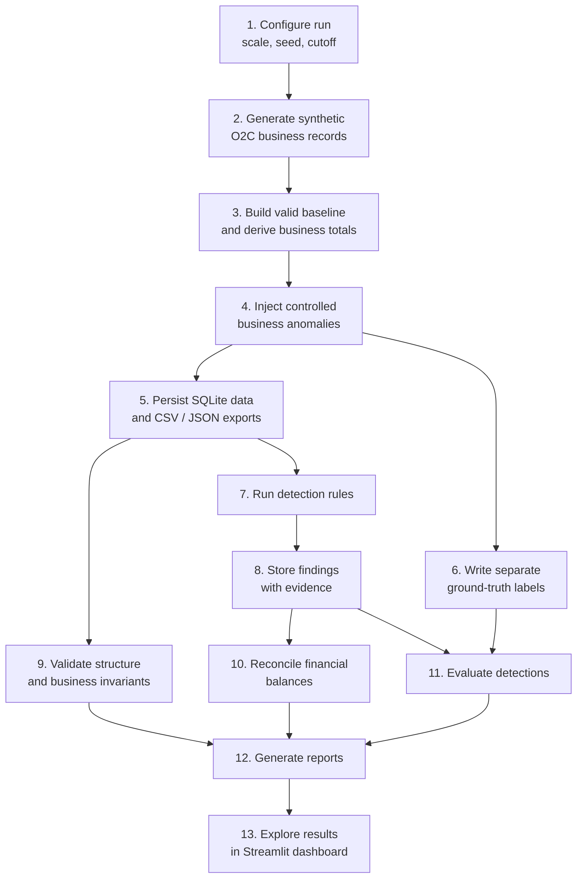
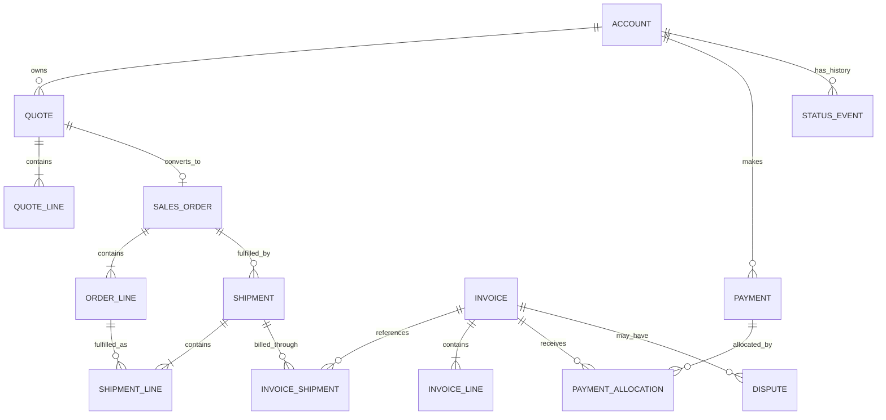

<div align="center">

# Order-to-Cash Revenue Leakage & Process Delay Analysis

**Follow every sale from quote to cash. Find where revenue leaks, where work stalls, and why.**

A reproducible, local analytics system for investigating order-to-cash (O2C) exceptions using synthetic business data, explainable detection rules, financial reconciliation, and a Streamlit dashboard.


</div>

---

## Project Overview

Order-to-cash processes connect customer accounts, quotes, orders, fulfilment, invoices, payments, and disputes. Each hand-off can introduce revenue leakage, receivables discrepancies, or process delays.

This project builds a controlled O2C environment using synthetic data, introduces known business exceptions, detects them with explainable Python/SQL rules, reconciles financial records, and evaluates the results against separately maintained ground-truth labels.

### At a glance

| Area | Description |
|---|---|
| Business problem | Identify revenue leakage, receivables discrepancies, and delays across the O2C lifecycle |
| Approach | Deterministic synthetic data, controlled anomaly injection, explainable detection rules |
| Storage | Local SQLite database with CSV/JSON exports |
| Interface | Five-tab Streamlit analytics dashboard |
| Reproducibility | Fixed seed, configuration, manifests, checksums, and reproducibility checks |
| Evaluation | Findings compared with separate ground-truth labels, including a clean-data negative control |
| Currency | INR; monetary values stored as integer paise |
| Data privacy | Synthetic data only; no external or personal business records used |

> **AI-assisted development disclosure:** This project was developed with Claude Code. The prompt history and disclosure are maintained in [`docs/prompt_history.md`](docs/prompt_history.md) and [`docs/ai_usage.md`](docs/ai_usage.md). The development and verification handover is documented in [`HANDOFF.md`](HANDOFF.md).

---

## Business Workflow

The O2C lifecycle represented by the project is:

```text
Account
   |
   v
Quote --> Quote Lines
   |
   | accepted
   v
Sales Order --> Order Lines
   |
   v
Shipment --> Shipment Lines
   |
   v
Invoice --> Invoice Lines
   |
   v
Payment --> Payment Allocations

Dispute --> Receivables / Collection Hold
```

A quote may be accepted and become a sales order. An order may be fulfilled through multiple shipments. Shipments may be invoiced separately or together. Payments may arrive late, in instalments, or be allocated across invoices. A dispute may affect the amount considered collectible.

Each transition is a potential control point:

- Goods shipped but not invoiced
- Invoice quantity or value exceeds fulfilment
- Duplicate invoice or payment allocation
- Order closed while an invoice remains unpaid
- Illegal or skipped status transition
- Dispute not correctly reflected in receivables
- Delayed fulfilment, invoicing, or collection

The project preserves lifecycle changes in `status_event` rather than relying only on a final status.

---

## Architecture

The project uses a **single local Python process and one SQLite database**. The core pipeline is batch-oriented and does not require a hosted AI service or external database server.

### System architecture



### Technology choices

| Technology | Role | Reason |
|---|---|---|
| Python | Generation, orchestration, detection, validation, evaluation | Readable implementation and broad standard-library support |
| SQLite | Relational transactional store and analytical queries | Local, serverless database suitable for batch analysis |
| SQL | Schema, joins, analytical views, and rule queries | Makes relational checks and evidence traceable |
| Streamlit | Interactive dashboard | Provides a local interface for exploring analytical results |
| pandas / Altair | Dashboard data handling and charts | Tabular analysis and visualization |
| pytest | Automated tests | Repeatable verification of core behaviour |

### Design principles

- **Deterministic inputs:** seed and configuration are explicit.
- **Valid baseline first:** generate internally consistent business records before introducing controlled exceptions.
- **Answer-key separation:** detection rules do not read `ground_truth.csv`.
- **Traceable findings:** each finding points to source records and supporting evidence.
- **Exact money arithmetic:** use integer paise instead of floating-point arithmetic for financial identities.
- **Event history:** preserve status transitions rather than overwriting historical state.
- **Local-first execution:** generated data and outputs remain on the local machine.
- **Explicit limitations:** synthetic-data performance is not presented as proof of real-world accuracy.

---

## Methodology and Execution Flow

The main entry point is `run.py`. The `all` command orchestrates the pipeline.



### Methodology steps

1. **Configure the run**  
   Select starter or full scale, seed, and business cutoff date.

2. **Generate business records**  
   Create accounts, products, quotes, quote lines, sales orders, order lines, shipments, invoices, payments, disputes, and status events.

3. **Establish valid business facts**  
   Derive totals from source lines and balances from ledger entries instead of randomizing calculated values.

4. **Inject controlled anomalies**  
   Introduce selected business exceptions while preserving valid primary keys, foreign keys, and relevant line arithmetic.

5. **Persist and export**  
   Write the SQLite database, CSV/JSON artifacts, ground-truth labels, and run manifest.

6. **Detect exceptions**  
   Run deterministic rules against transactional records and lifecycle history.

7. **Validate and reconcile**  
   Check structural integrity, business invariants, and financial identities.

8. **Evaluate**  
   Compare findings with ground-truth labels and run a clean-data negative control.

9. **Review**  
   Use the dashboard and supporting evidence to investigate findings and explain the business impact.

> **Evaluation boundary:** `ground_truth.csv` is used for evaluation after detection. It is not an input to the detection rules. This separation prevents the detector from reading the answer key.

---

## What the System Does

### 1. Generates reproducible synthetic data

The same seed produces the same generated dataset in the same supported environment. Starter and full scales use the same generation logic with different data volumes.

### 2. Builds valid records before injecting anomalies

The generator first creates internally consistent business records. It then introduces controlled anomalies, allowing detection rules to be tested against realistic-looking exceptions without simply flagging broken database rows.

### 3. Preserves lifecycle history

Business state changes are represented in `status_event`. Historical transitions are retained rather than relying only on the current status.

### 4. Detects 11 exception types

Each finding includes its rule, source record, related records, severity, expected and observed behaviour, financial impact, and supporting evidence.

### 5. Reconciles financial records

Six reconciliation identities compare the receivables ledger with source transaction tables. The expected difference is exactly zero paise.

### 6. Evaluates detection quality

The evaluator reports true positives, false positives, false negatives, precision, recall, and F1 overall and by issue type or label source. It also examines monetary amounts associated with matched findings.

### 7. Provides an analytics dashboard

A five-tab Streamlit dashboard supports exploration of exceptions, financial exposure, reconciliation, and process delays.

---

## Data Model

### Core entities

The eleven core entities are:

```text
account
quote
quote_line
sales_order
order_line
shipment
invoice
invoice_line
payment
dispute
status_event
```

### Supporting tables

| Supporting table | Purpose |
|---|---|
| `shipment_line` | A shipment can carry many order lines; an order line can ship in parts |
| `invoice_shipment` | An invoice can bill one or more shipments |
| `payment_allocation` | A payment can settle multiple invoices, and an invoice can receive multiple payments |
| `ar_ledger_entry` | Append-only receivables ledger and source of receivable balances |
| `product` | Product catalogue referenced by quote lines |

### Relationship overview



The schema defines primary keys, foreign keys, relationships, and constraints. Field definitions and detailed cardinalities are documented in [`docs/data_dictionary.md`](docs/data_dictionary.md).

### Business ID conventions

The project uses deterministic, human-readable business IDs:

| Entity | ID format | Example |
|---|---|---|
| Quote | `QTE-2026-######` | `QTE-2026-000001` |
| Sales order | `SO-2026-######` | `SO-2026-000001` |
| Shipment | `SHP-2026-######` | `SHP-2026-000001` |
| Invoice | `INV-2026-######` | `INV-2026-000001` |
| Payment | `PAY-2026-######` | `PAY-2026-000001` |
| Dispute | `DSP-2026-######` | `DSP-2026-000001` |

The generator creates these identifiers, propagates them through related records, and the SQLite schema enforces the expected patterns.

Money is represented in INR integer paise to avoid floating-point rounding in financial calculations.

---

## Detection Scenarios

The project includes the five required negative scenarios and additional exception coverage.

| Scenario | Business issue |
|---|---|
| **Underbilling** | Goods are fulfilled but the corresponding value is not fully invoiced |
| **Overbilling** | Invoice quantity or amount exceeds fulfilled quantity or value |
| **Duplicate invoice** | The same business fulfilment is billed more than once |
| **Duplicate payment allocation** | A payment is applied more than once |
| **Closed order with unpaid invoice** | An order is closed while receivables remain open |
| **Illegal status transition** | A required lifecycle state is skipped |
| **Dispute not reflected in AR** | An open dispute has no or insufficient ledger hold |
| **Fulfilment delay** | An order takes longer than the configured fulfilment target |
| **Invoicing delay** | A shipment takes longer than the configured invoicing target |
| **Long overdue** | A receivable exceeds the configured overdue threshold |
| **Short payment** | A payment is below the amount expected to settle an invoice |

The dataset also includes look-alike cases that should not be flagged, such as similar invoices for distinct shipments, voided and reissued invoices, and boundary cases around configured thresholds.

Anomalies are designed to preserve valid keys and line arithmetic. Detailed rule definitions and evidence logic are documented in [`docs/business_rules.md`](docs/business_rules.md).

---

## Financial Measures

The dashboard keeps distinct financial concepts separate to avoid overstating leakage.

| Measure | Interpretation |
|---|---|
| **Underbilled revenue** | Potential income lost because fulfilled goods were not fully billed |
| **Overbilled exposure** | Customer overcharge exposure; may require credit or refund |
| **Duplicate-billing exposure** | Amount billed more than once; not automatically recognized as income |
| **Overdue receivables** | Collection risk; money may still be collected |
| **Short-paid balance** | Remaining amount after an insufficient payment |
| **Payment allocation discrepancy** | Receivables may appear lower than they actually are |
| **Dispute hold** | Amount subject to dispute; not treated as freely collectible |
| **Unapplied cash** | Received cash not yet allocated to invoices |

These measures are not blindly summed into one “loss” number. The project distinguishes potential revenue leakage from customer exposure and collection risk.

Full formulas, source records, and limitations are documented in [`docs/business_rules.md`](docs/business_rules.md).

---

## Quick Start

### Prerequisites

- Python **3.11 or newer**
- Git, if cloning the repository
- A terminal: PowerShell, Git Bash, or a compatible shell

The latest local starter validation was run on Windows using Python **3.13.7**.

### 1. Clone the repository

```bash
git clone https://github.com/Manusha-M/AI-order-to-cash-detection-system.git
cd AI-order-to-cash-detection-system
```

### 2. Create a virtual environment

**Windows PowerShell:**

```powershell
py -3 -m venv .venv
```

**Git Bash / macOS / Linux:**

```bash
python3 -m venv .venv
```

### 3. Install dependencies

**Windows PowerShell:**

```powershell
.\.venv\Scripts\python.exe -m pip install -r requirements.txt
```

**Git Bash on Windows:**

```bash
./.venv/Scripts/python.exe -m pip install -r requirements.txt
```

**macOS / Linux:**

```bash
.venv/bin/python -m pip install -r requirements.txt
```

### 4. Run the starter pipeline

**Windows PowerShell:**

```powershell
.\.venv\Scripts\python.exe run.py all --scale starter
```

**Git Bash on Windows:**

```bash
./.venv/Scripts/python.exe run.py all --scale starter
```

**macOS / Linux:**

```bash
.venv/bin/python run.py all --scale starter
```

### 5. Launch the dashboard

**Windows PowerShell:**

```powershell
.\.venv\Scripts\python.exe -m streamlit run app\dashboard.py
```

**Git Bash on Windows:**

```bash
./.venv/Scripts/python.exe -m streamlit run app/dashboard.py
```

**macOS / Linux:**

```bash
.venv/bin/python -m streamlit run app/dashboard.py
```

Streamlit will print a local URL, usually `http://localhost:8501`. Open it in your browser.

> The virtual environment does not need to be activated if you invoke its Python executable directly.

---

## Pipeline Commands

Run commands from the repository root. The default seed is `20261022`; use `--seed` to select another seed.

| Task | Command |
|---|---|
| Full starter pipeline | `python run.py all --scale starter` |
| Full dataset pipeline | `python run.py all --scale full` |
| Generate data only | `python run.py generate --scale full` |
| Detect exceptions | `python run.py detect --scale full` |
| Validate data | `python run.py validate --scale full` |
| Reconcile balances | `python run.py reconcile --scale full` |
| Evaluate against ground truth | `python run.py evaluate --scale full` |
| Clean-data negative control | `python run.py negative-control --scale full` |
| Two-run reproducibility | `python run.py reproduce --scale full` |
| Seed sweep | `python scripts/seed_sweep.py --scale starter` |
| Automated tests | `python -m pytest -q` |
| Dashboard | `python -m streamlit run app/dashboard.py` |

Use the virtual-environment Python executable if the environment is not activated.

**Order matters:** run detection before reconciliation and evaluation, because those steps consume detection findings. The `all` command orchestrates the complete sequence.

The full pipeline is reported to take approximately two minutes, depending on the machine and selected scale.

---

## Dashboard

The Streamlit dashboard provides five tabs for reviewing generated analytical outputs.

Use it to explore:

- O2C business and financial summary
- Detected exceptions and supporting evidence
- Revenue leakage and customer exposure
- Receivables and reconciliation results
- Process-stage delays and timing distributions

The dashboard is a local analytical interface. It is not a hosted production service or a real-time connection to an ERP.

---

## Validation and Evaluation

### What is checked

- Referential and structural integrity
- Business invariants and transaction relationships
- Line totals and derived amounts
- Receivables ledger consistency
- Six financial reconciliation identities
- Reproducibility for the selected seed and environment
- Detection findings against separate ground-truth labels
- Negative-control behaviour on clean data
- Automated tests for core project behaviour

### Latest local starter verification

The following results were obtained locally on Windows using Python 3.13.7:

| Verification | Result |
|---|---:|
| Structural checks | **98 / 98 passed** |
| Business anomaly tie-outs | **6 / 6 matched ground truth** |
| Automated tests | **208 passed** |
| Test duration | 69.61 seconds |

Commands used:

```bash
python run.py validate --scale starter
pytest
```

These results apply to the **starter scale**. Run the full-scale pipeline and checks separately before reporting full-scale verification.

### How to interpret detection scores

The project distinguishes three label sources:

| Label source | Meaning | Evidential strength |
|---|---|---|
| `injected` | A valid business record was deliberately changed to create an anomaly | Strongest available controlled test |
| `plan` | The generator planned an outcome and labelled it | Useful, but tied to generator design |
| `rule` | The label re-applies the documented rule | Weakest; a perfect score is close to guaranteed |

A perfect score on synthetic data demonstrates that the rules behave as designed against generated scenarios. **It does not establish real-world accuracy.** The generator, labels, and detector share assumptions.

### Reproduce the full-scale report

```bash
python run.py all --scale full --seed 20261022
python -m pytest -q
```

Then inspect:

- [`docs/validation_report.md`](docs/validation_report.md)
- [`docs/reproducibility.md`](docs/reproducibility.md)
- [`outputs/`](outputs/)

---

## Assumptions and Limitations

### Assumptions

- One currency: INR; tax is excluded.
- Fulfilment, invoicing, and overdue targets are configurable assumptions, not universal business standards.
- The receivables ledger gives a concrete interpretation to “reflected in receivables.”
- Synthetic customer names and transaction data are invented.
- The business cutoff is `2026-09-30`; transactions scheduled after it remain in-flight.

### Limitations

- Synthetic data cannot represent every real ERP configuration or business process.
- Rules detect the patterns they were written for; unknown patterns may be missed.
- Thresholds are single values; actual targets can vary by customer, product, or contract.
- Dispute credits are associated with invoices, so overbilling is reported gross with credits shown in evidence.
- An overbilled line that also has shipped-but-unbilled goods can remain below a rule threshold until billing catches up; reconciliation can still show the difference.
- Reversed payments are modelled only before allocation.
- SQLite is a local, single-writer database; this is a batch analytics prototype, not a live multi-user production system.
- Checksums were measured on a specific Python version. Another version may produce different but valid data; run reproducibility checks in the target environment.

---

## Repository Structure

```text
AI-order-to-cash-detection-system/
├── run.py                  # Command-line pipeline entry point
├── src/                    # Generator, detector, validation, reconciliation, evaluation
├── sql/                    # Database schema and analytical views
├── app/
│   └── dashboard.py         # Streamlit dashboard
├── tests/                  # Automated tests
├── scripts/                # Seed sweep, report writer, supporting utilities
├── data/
│   └── starter/             # Starter-scale data/artifacts
├── outputs/                 # Generated reports and results
├── docs/
│   ├── architecture.md
│   ├── business_rules.md
│   ├── data_dictionary.md
│   ├── decisions.md
│   ├── development_log.md
│   ├── prompt_history.md
│   ├── ai_usage.md
│   ├── validation_report.md
│   ├── reproducibility.md
│   └── final_audit.md
├── requirements.txt
├── pytest.ini
├── .gitignore
└── HANDOFF.md               # Setup and verification handover
```

---

## Development History and Evidence

The development log is maintained separately from Git history to document how the solution evolved during local development.

| Document | Purpose |
|---|---|
| [`HANDOFF.md`](HANDOFF.md) | Clean setup and verification handover |
| [`docs/architecture.md`](docs/architecture.md) | Architecture and data flow |
| [`docs/business_rules.md`](docs/business_rules.md) | Rule definitions and financial formulas |
| [`docs/data_dictionary.md`](docs/data_dictionary.md) | Schema and field reference |
| [`docs/decisions.md`](docs/decisions.md) | Assumptions, decisions, and trade-offs |
| [`docs/requirements_matrix.md`](docs/requirements_matrix.md) | Requirement-to-implementation traceability |
| [`docs/validation_report.md`](docs/validation_report.md) | Recorded test and evaluation results |
| [`docs/reproducibility.md`](docs/reproducibility.md) | Reproducibility method and results |
| [`docs/development_log.md`](docs/development_log.md) | Development timeline and evidence |
| [`docs/ai_usage.md`](docs/ai_usage.md) | AI usage disclosure |
| [`docs/prompt_history.md`](docs/prompt_history.md) | Recorded prompts |
| [`docs/final_audit.md`](docs/final_audit.md) | Final audit and open items |

---

## AI-Assisted Development and Individual Ownership

This project was developed with Claude Code. The prompt record and AI usage disclosure describe:

- Where AI accelerated development
- Where AI-generated implementation or documentation was used
- What was reviewed, changed, or validated
- Testing and verification performed
- Known limitations and open items

The candidate should review these documents carefully and be prepared to explain the core logic, design decisions, dependencies, and limitations during the walkthrough.

---

## Next Steps

Potential improvements include:

- Test on Python 3.11 and 3.12, and on a second computer.
- Have a human reviewer examine the rules and final code.
- Match dispute credits to order lines to report overbilling net of credits.
- Configure targets by customer and product rather than using one threshold.
- Model payments reversed after allocation.
- Test the rules on real, anonymized business data with permission.
- Add continuous integration for documented validation and tests.

---

## Walkthrough Preparation

Be ready to demonstrate and explain:

1. How to install dependencies and run the pipeline.
2. How synthetic data is generated and anomalies are injected.
3. Why the detector cannot access `ground_truth.csv`.
4. How a finding is traced to source records and evidence.
5. How the six financial identities are reconciled.
6. How precision, recall, and F1 are calculated—and what the scores do **not** prove.
7. Why the architecture and technology choices were made.
8. Which parts AI accelerated, what you reviewed, and what you personally validated.

**The goal is not just to show that the project runs. It is to show that you understand why it works, how you tested it, and where its boundaries are.**

