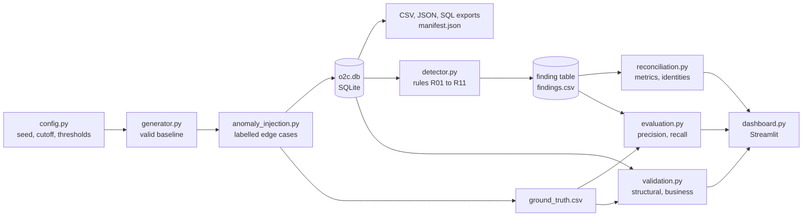
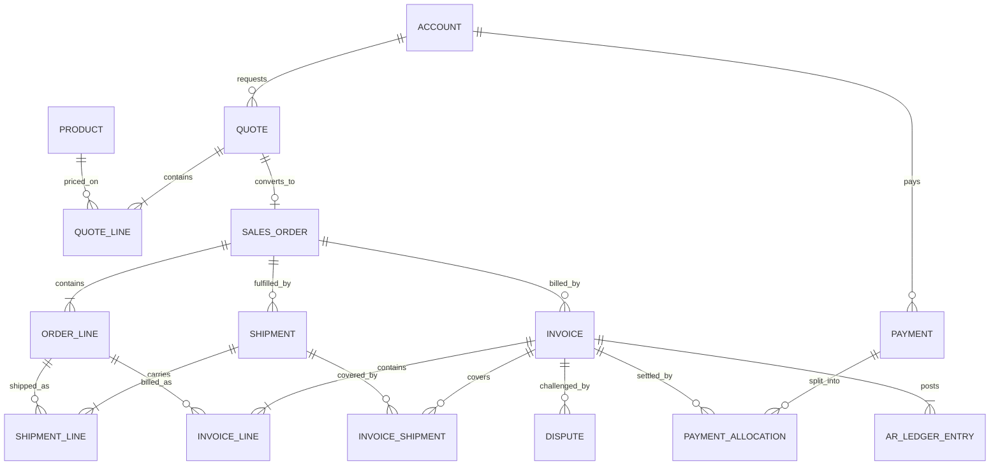

# Architecture

A single-process Python pipeline over one SQLite file. There are no servers, queues or cloud services: the challenge is about correct data and rules, and everything has to run on a laptop.

## Pipeline

The arrow that matters is the one that does not exist: nothing runs from `ground_truth.csv` to `detector.py`. Labels are only read afterwards, to score the result. Invoice and allocation IDs are renumbered by date after injection, so even an ID cannot give the answer away.

## Entity relationships

`status_event` is not drawn because it links to six tables through `entity_type` and `entity_id`.

## Modules

| File | Responsibility |
|---|---|
| `run.py` | Command-line entry point; one function per pipeline step |
| `src/config.py` | Seed, cutoff, thresholds, enums, scale profiles |
| `src/lifecycle.py` | State machines shared by generator, detector and validator |
| `src/generator.py` | Builds the valid world in process order |
| `src/anomaly_injection.py` | Plants labelled anomalies and writes labels |
| `src/database.py` | SQLite build, exports, checksums, manifest |
| `src/detector.py` | Rules R01 to R11; reads the database only |
| `src/reconciliation.py` | Metrics and identities |
| `src/evaluation.py` | Compares findings with labels |
| `src/validation.py` | Structural checks and anomaly tie-outs |
| `src/reproducibility.py` | Two-process determinism check |
| `sql/schema.sql` | Tables and constraints |
| `sql/analytics.sql` | Views for live invoices, balances, aging, line positions and billing lag, all as of the cutoff |
| `app/dashboard.py` | Read-only Streamlit views |
| `scripts/seed_sweep.py` | Repeats the pipeline on other seeds |
| `scripts/write_reports.py` | Writes measured reports from `outputs/` |
| `scripts/make_handover_zip.py` | Builds the clean transfer archive |

## How the generator stays honest

Each phase owns a named random stream, for example `20261022:shipments`. A change in one phase cannot reshuffle another.

Payments are planned as chunks first. Then `replay_receivables` walks each invoice's payments and dispute steps in date order. That single replay writes the allocations, the ledger and the status events, so they cannot disagree.

Exact row counts come from adjustment rather than luck: quotes are ranked by a weighted score and the top 7,000 are accepted, shipments are consolidated onto invoices until the count is exact, and instalments are merged or split until there are exactly 15,000 payments.

## Data flow at the cutoff

Anything scheduled after 2026-09-30 simply has not happened. A shipment planned for October stays PLANNED, and a payment due later is not created. This is what gives the data realistic in-flight records instead of everything finishing neatly.
